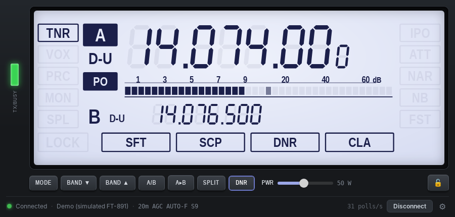
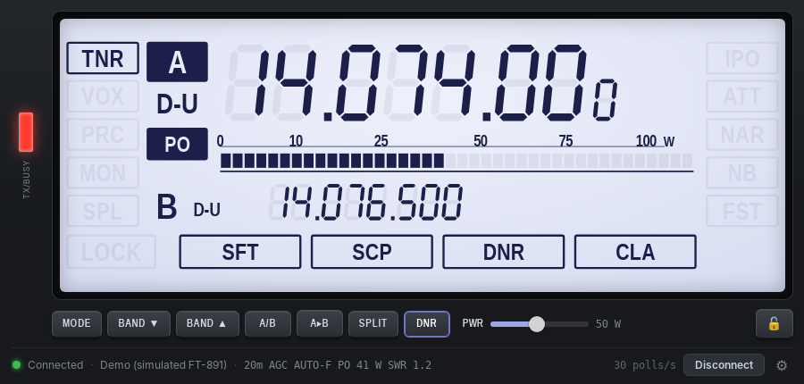

# 891 Monitor

> **⚠️ Experimental software, made for personal use.** Use it at your own risk. The author accepts no responsibility for any damage to your radio or loss of settings. See [Disclaimer](#disclaimer).

A free desktop display and remote panel for the **Yaesu FT-891**, for Windows, macOS and Linux (including Raspberry Pi). It shows what the radio is doing on a large copy of the radio's own LCD, read over the CAT port, and lets you tune, change mode and band and switch a few receive functions from the computer.

Companion to [817 Monitor](https://github.com/yoramrotbach/ft817-monitor) for the FT-817/818.

**It cannot transmit.** Every command passes through an allow-list in code. Transmit (`TX`, `MX`), tuner start (`AC`), VOX, CW keying, menu writes (`EX`), memory writes and everything else not on the list are refused before they reach the port, and tests check this.




## What it shows

The layout follows the FT-891's LCD:

| Area | Receive | Transmit |
|---|---|---|
| Left column | TNR, VOX, PRC, MON, SPL, LOCK | same |
| Right column | IPO, ATT, NAR, NB, FST | same |
| VFO box | `A`, or `M` + channel number in memory mode | same |
| Mode | LSB, USB, CWU, CWL, AM, AM-N, FM, FM-N, R-L, R-U, D-L, D-U | same |
| Frequency | VFO-A to 1 Hz, radio style `14.074.00`₀ | same |
| Meter | S-meter, S1 to +60 dB, with peak hold | the meter chosen with the radio's METER key: PO, SWR, ALC, COMP or ID, with a matching scale |
| VFO-B row | VFO-B frequency and mode; clarifier offset when CLAR is on | same |
| Function keys | a label row of your choice (Settings) | same |
| TX/BUSY LED | green when the squelch is open | red |

The status bar adds the band, AGC setting, S-reading, and while transmitting, power output in watts and SWR.

## Controls

All controls are refused while the radio is transmitting. Tuning, mode, band and VFO changes are also refused while the radio's dial LOCK is on.

| Action | How |
|---|---|
| Tune | Mouse wheel over a frequency digit steps that digit (10 MHz down to 10 Hz). ↑/↓ keys: 10 Hz; Shift 100 Hz; Ctrl 1 kHz |
| Type a frequency | Click the frequency, type MHz (`14.074`), kHz (`7074`) or Hz, then Enter |
| Mode | Click the mode on the LCD, or the MODE key |
| Band | BAND ▼ / BAND ▲, or Page Down / Page Up |
| VFOs | A/B swaps VFO-A and VFO-B; A▸B copies A to B; SPLIT toggles split |
| Receive functions | Click IPO, ATT, NAR, NB, FST, SPL or LOCK on the LCD; DNR key; DNR, NB, ATT, IPO and NAR function-key labels |
| Power | PWR slider, 5–100 W, applied when you let go |
| View-only | 🔓/🔒 button: blocks every control from this window (saved) |

You can also turn control off completely in Settings.

Not controllable on purpose: TNR (starting a tune cycle transmits), VOX (it can key the transmitter), PRC and MON, menus and memories.

## Connecting

**Direct USB (recommended).** Connect the radio's USB jack to the computer. It appears as **two** serial ports (Silicon Labs CP210x driver). Pick the **Enhanced** port; the Standard port is for PTT and keying.

- Baud rate must match menu **05-06 CAT RATE** (factory default 4800; 38400 recommended).
- Keep **RTS/CTS flow control** on while menu **05-08 CAT RTS** is ENABLE (the default).
- Format is 8 data bits, no parity, 2 stop bits (1 stop bit is available in Settings).
- DTR is always held low. Without flow control, RTS is held low too.
- Only one program can use the Enhanced port at a time.

**Hamlib rigctld (shared).** To run alongside WSJT-X, a logger or other CAT software, start rigctld and point all programs at it:

```
rigctld -m 1036 -r COM3 -s 38400
```

Through rigctld the app polls more gently (about 10 times a second). The NAR and FST indicators, the selected meter and the VFO-B row aren't available that way, and neither are the NAR, ATT, IPO and FST controls.

**Demo.** A simulated FT-891 on 20 m FT8, alternating 15-second receive and transmit periods. Start it from Settings, or launch with `--demo`.

## Install

Download an installer from [Releases](../../releases). Builds are unsigned: Windows SmartScreen and macOS Gatekeeper will warn on first launch.

- **Windows:** `.msi` or `-setup.exe`. Install the Silicon Labs CP210x driver from Yaesu's site if the ports don't appear.
- **macOS:** `.dmg` (Apple Silicon and Intel). If macOS says the app is damaged, run `xattr -cr "/Applications/891 Monitor.app"`.
- **Linux / Raspberry Pi (64-bit):** `.deb` or `.AppImage`. Add yourself to the `dialout` group for serial access: `sudo usermod -aG dialout $USER`, then log out and back in.

## Build from source

Requires Rust (stable), Node 18+, and on Linux `libwebkit2gtk-4.1-dev libayatana-appindicator3-dev librsvg2-dev libudev-dev`.

```
npm ci
npm run demo          # run against the simulated radio
npm run build         # installers for this platform
cargo test --workspace
```

Pushing a tag such as `v0.1.0` builds installers for all platforms through GitHub Actions and attaches them to a draft release.

## How it works

- `crates/ft891-cat`: the CAT protocol: allow-list, command builders, decoders, serial link and the simulated radio. See [docs/PROTOCOL.md](docs/PROTOCOL.md).
- `src-tauri`: the poller thread (about 30 cycles a second on a direct link) and the control queue.
- `ui`: the LCD, drawn as one SVG, and the controls.

## Known limits

- Not yet tested against a real FT-891, only against the simulator and the published CAT reference.
- The radio doesn't report which A/B/C function-key row is showing, so the label row is a setting.
- Meter scales for SWR, ALC, COMP and ID are approximate; the S-meter and power calibration follow Hamlib's FT-891 tables.
- QMB, PMS and the spectrum scope screen aren't shown.

## Disclaimer

This software is provided "as is", without warranty of any kind. It sends commands that change the radio's state (frequency, mode, band, a few receive functions and power level). It is designed never to transmit or change menus, but you use it at your own risk.

## License

MIT. Yaesu and FT-891 are trademarks of Yaesu Musen Co., Ltd. This project is not affiliated with Yaesu; the display is an independent drawing modeled on the radio's layout.
